# Pipeline de la app (spec 047)

`.github/workflows/app-ci.yml` lo genera `tools/ci/generar_pipeline.py`: **cada archivo de prueba es un job**, así el grafo de GitHub Actions muestra cada prueba por separado y la protección de ramas exige cada una por nombre. El pipeline crece con las pruebas; eso es intencional: un merge solo ocurre si pasaron todas.

## Grafo completo (generado del workflow)

Vista como imagen: [pipeline-grafo.png](img/pipeline-grafo.png). Es el mismo grafo que GitHub dibuja en Actions → la ejecución → «Summary». Cada caja es un job; las flechas son `needs`. Los jobs de firma y Play aparecen omitidos fuera de `release/*` y `main`, y «revisión de dependencias del PR» solo en Pull Requests.

```mermaid
flowchart LR
  J0["Pipeline · al día con las pruebas"]
  J1["Preparar · Flutter y dependencias"]
  J2["Calidad · formato"]
  J3["Calidad · análisis estático"]
  J4["Unidad · almacen-local"]
  J5["Unidad · api-modes"]
  J6["Unidad · asistente-y-dispositivos-fake"]
  J7["Unidad · auth-parsing"]
  J8["Unidad · fake-account"]
  J9["Unidad · fake-discovery"]
  J10["Unidad · fake-messages"]
  J11["Unidad · fake-orders"]
  J12["Unidad · fake-requests"]
  J13["Unidad · filters"]
  J14["Unidad · ml-categoria"]
  J15["Unidad · models"]
  J16["Unidad · publish-rules"]
  J17["Unidad · push-mensajes"]
  J18["Unidad · validation"]
  J19["Integración · cache-sin-conexion"]
  J20["Integración · http-asistente-dispositivos"]
  J21["Integración · http-cuenta"]
  J22["Integración · http-descubrimiento"]
  J23["Integración · http-guardados-contacto"]
  J24["Integración · http-imagenes"]
  J25["Integración · http-mensajes"]
  J26["Integración · http-pedidos"]
  J27["Integración · http-perfil"]
  J28["Integración · http-solicitudes-interes"]
  J29["Integración · push-controlador"]
  J30["Integración · resiliencia"]
  J31["Integración · sesion"]
  J32["Integración · sincronizacion"]
  J33["Seguridad · cabeceras-y-subidas"]
  J34["Seguridad · cache-local-seguro"]
  J35["Seguridad · enlaces-profundos"]
  J36["Seguridad · ia-sin-datos-personales"]
  J37["Seguridad · privacidad"]
  J38["Seguridad · push-seguro"]
  J39["Seguridad · registros-sin-datos-sensibles"]
  J40["Seguridad · secretos-en-codigo"]
  J41["Seguridad · transporte"]
  J42["Seguridad · secretos en el historial (gitleaks)"]
  J43["Seguridad · vulnerabilidades en dependencias (OSV)"]
  J44["Seguridad · AndroidManifest y build"]
  J45["Seguridad · workflows (actionlint y permisos)"]
  J46["Seguridad · revisión de dependencias del PR"]
  J47["Versión · matriz y SemVer"]
  J48["Calidad · cobertura combinada"]
  J49["Construir · APK de prueba"]
  J50["CI · todo verde"]
  J51["Construir · AAB firmado"]
  J52["Play Store · pruebas internas"]
  J53["Play Store · producción"]
  J0 --> J1
  J1 --> J2
  J1 --> J3
  J2 --> J4
  J3 --> J4
  J2 --> J5
  J3 --> J5
  J2 --> J6
  J3 --> J6
  J2 --> J7
  J3 --> J7
  J2 --> J8
  J3 --> J8
  J2 --> J9
  J3 --> J9
  J2 --> J10
  J3 --> J10
  J2 --> J11
  J3 --> J11
  J2 --> J12
  J3 --> J12
  J2 --> J13
  J3 --> J13
  J2 --> J14
  J3 --> J14
  J2 --> J15
  J3 --> J15
  J2 --> J16
  J3 --> J16
  J2 --> J17
  J3 --> J17
  J2 --> J18
  J3 --> J18
  J4 --> J19
  J5 --> J19
  J6 --> J19
  J7 --> J19
  J8 --> J19
  J9 --> J19
  J10 --> J19
  J11 --> J19
  J12 --> J19
  J13 --> J19
  J14 --> J19
  J15 --> J19
  J16 --> J19
  J17 --> J19
  J18 --> J19
  J4 --> J20
  J5 --> J20
  J6 --> J20
  J7 --> J20
  J8 --> J20
  J9 --> J20
  J10 --> J20
  J11 --> J20
  J12 --> J20
  J13 --> J20
  J14 --> J20
  J15 --> J20
  J16 --> J20
  J17 --> J20
  J18 --> J20
  J4 --> J21
  J5 --> J21
  J6 --> J21
  J7 --> J21
  J8 --> J21
  J9 --> J21
  J10 --> J21
  J11 --> J21
  J12 --> J21
  J13 --> J21
  J14 --> J21
  J15 --> J21
  J16 --> J21
  J17 --> J21
  J18 --> J21
  J4 --> J22
  J5 --> J22
  J6 --> J22
  J7 --> J22
  J8 --> J22
  J9 --> J22
  J10 --> J22
  J11 --> J22
  J12 --> J22
  J13 --> J22
  J14 --> J22
  J15 --> J22
  J16 --> J22
  J17 --> J22
  J18 --> J22
  J4 --> J23
  J5 --> J23
  J6 --> J23
  J7 --> J23
  J8 --> J23
  J9 --> J23
  J10 --> J23
  J11 --> J23
  J12 --> J23
  J13 --> J23
  J14 --> J23
  J15 --> J23
  J16 --> J23
  J17 --> J23
  J18 --> J23
  J4 --> J24
  J5 --> J24
  J6 --> J24
  J7 --> J24
  J8 --> J24
  J9 --> J24
  J10 --> J24
  J11 --> J24
  J12 --> J24
  J13 --> J24
  J14 --> J24
  J15 --> J24
  J16 --> J24
  J17 --> J24
  J18 --> J24
  J4 --> J25
  J5 --> J25
  J6 --> J25
  J7 --> J25
  J8 --> J25
  J9 --> J25
  J10 --> J25
  J11 --> J25
  J12 --> J25
  J13 --> J25
  J14 --> J25
  J15 --> J25
  J16 --> J25
  J17 --> J25
  J18 --> J25
  J4 --> J26
  J5 --> J26
  J6 --> J26
  J7 --> J26
  J8 --> J26
  J9 --> J26
  J10 --> J26
  J11 --> J26
  J12 --> J26
  J13 --> J26
  J14 --> J26
  J15 --> J26
  J16 --> J26
  J17 --> J26
  J18 --> J26
  J4 --> J27
  J5 --> J27
  J6 --> J27
  J7 --> J27
  J8 --> J27
  J9 --> J27
  J10 --> J27
  J11 --> J27
  J12 --> J27
  J13 --> J27
  J14 --> J27
  J15 --> J27
  J16 --> J27
  J17 --> J27
  J18 --> J27
  J4 --> J28
  J5 --> J28
  J6 --> J28
  J7 --> J28
  J8 --> J28
  J9 --> J28
  J10 --> J28
  J11 --> J28
  J12 --> J28
  J13 --> J28
  J14 --> J28
  J15 --> J28
  J16 --> J28
  J17 --> J28
  J18 --> J28
  J4 --> J29
  J5 --> J29
  J6 --> J29
  J7 --> J29
  J8 --> J29
  J9 --> J29
  J10 --> J29
  J11 --> J29
  J12 --> J29
  J13 --> J29
  J14 --> J29
  J15 --> J29
  J16 --> J29
  J17 --> J29
  J18 --> J29
  J4 --> J30
  J5 --> J30
  J6 --> J30
  J7 --> J30
  J8 --> J30
  J9 --> J30
  J10 --> J30
  J11 --> J30
  J12 --> J30
  J13 --> J30
  J14 --> J30
  J15 --> J30
  J16 --> J30
  J17 --> J30
  J18 --> J30
  J4 --> J31
  J5 --> J31
  J6 --> J31
  J7 --> J31
  J8 --> J31
  J9 --> J31
  J10 --> J31
  J11 --> J31
  J12 --> J31
  J13 --> J31
  J14 --> J31
  J15 --> J31
  J16 --> J31
  J17 --> J31
  J18 --> J31
  J4 --> J32
  J5 --> J32
  J6 --> J32
  J7 --> J32
  J8 --> J32
  J9 --> J32
  J10 --> J32
  J11 --> J32
  J12 --> J32
  J13 --> J32
  J14 --> J32
  J15 --> J32
  J16 --> J32
  J17 --> J32
  J18 --> J32
  J3 --> J33
  J3 --> J34
  J3 --> J35
  J3 --> J36
  J3 --> J37
  J3 --> J38
  J3 --> J39
  J3 --> J40
  J3 --> J41
  J0 --> J42
  J1 --> J43
  J0 --> J44
  J0 --> J45
  J0 --> J46
  J0 --> J47
  J4 --> J48
  J5 --> J48
  J6 --> J48
  J7 --> J48
  J8 --> J48
  J9 --> J48
  J10 --> J48
  J11 --> J48
  J12 --> J48
  J13 --> J48
  J14 --> J48
  J15 --> J48
  J16 --> J48
  J17 --> J48
  J18 --> J48
  J19 --> J48
  J20 --> J48
  J21 --> J48
  J22 --> J48
  J23 --> J48
  J24 --> J48
  J25 --> J48
  J26 --> J48
  J27 --> J48
  J28 --> J48
  J29 --> J48
  J30 --> J48
  J31 --> J48
  J32 --> J48
  J33 --> J48
  J34 --> J48
  J35 --> J48
  J36 --> J48
  J37 --> J48
  J38 --> J48
  J39 --> J48
  J40 --> J48
  J41 --> J48
  J48 --> J49
  J47 --> J49
  J42 --> J49
  J43 --> J49
  J44 --> J49
  J45 --> J49
  J0 --> J50
  J1 --> J50
  J2 --> J50
  J3 --> J50
  J47 --> J50
  J4 --> J50
  J5 --> J50
  J6 --> J50
  J7 --> J50
  J8 --> J50
  J9 --> J50
  J10 --> J50
  J11 --> J50
  J12 --> J50
  J13 --> J50
  J14 --> J50
  J15 --> J50
  J16 --> J50
  J17 --> J50
  J18 --> J50
  J19 --> J50
  J20 --> J50
  J21 --> J50
  J22 --> J50
  J23 --> J50
  J24 --> J50
  J25 --> J50
  J26 --> J50
  J27 --> J50
  J28 --> J50
  J29 --> J50
  J30 --> J50
  J31 --> J50
  J32 --> J50
  J33 --> J50
  J34 --> J50
  J35 --> J50
  J36 --> J50
  J37 --> J50
  J38 --> J50
  J39 --> J50
  J40 --> J50
  J41 --> J50
  J42 --> J50
  J43 --> J50
  J44 --> J50
  J45 --> J50
  J46 --> J50
  J48 --> J50
  J49 --> J50
  J50 --> J51
  J47 --> J51
  J51 --> J52
  J51 --> J53
```



| Etapa | Jobs | Falla si… |
|---|---|---|
| Gobierno | Pipeline · al día con las pruebas | hay un `*_test.dart` sin job o los checks de Terraform no coinciden |
| Preparación | Preparar · Flutter y dependencias | `pubspec.lock` no coincide (`--enforce-lockfile`) |
| Calidad | formato, análisis estático | falta `dart format` o hay errores/avisos del analizador |
| Unidad | 1 job por `test/unit/*_test.dart` | falla una regla, modelo o flujo de la API de ejemplo |
| Integración | 1 job por `test/integration/*_test.dart` (necesitan toda la unidad) | cambia una ruta, método, cuerpo o cabecera del contrato; falla la resiliencia o la sesión |
| Seguridad | 1 job por `test/security/*_test.dart` + gitleaks, OSV, AndroidManifest, workflows, revisión de dependencias | secretos, http, `print`, enlaces externos, Bearer en subidas, sin `allowBackup=false`, acciones sin SHA, vulnerabilidades |
| Versión | Versión · matriz y SemVer | la versión del pubspec no está en [la matriz](versionamiento.md) o no coincide con `release/x.y.z` |
| Cobertura | Calidad · cobertura combinada | capa lógica bajo `MIN_COVERAGE` (45 %, constitución §8) |
| Construcción | Construir · APK de prueba | el APK no compila |
| Compuerta | CI · todo verde | cualquier job anterior en falla o cancelado |
| Entrega | AAB firmado, Play internas / producción | faltan secretos de firma o `GOOGLE_SERVICES_JSON`, `API_BASE_URL` o `LANDING_URL` no son HTTPS, gradle sin firma; producción espera aprobación |

## Agregar una prueba

1. Crea el archivo en la capa correcta: `src/mobile/nexo_app/test/{unit|integration|security}/<nombre>_test.dart`.
2. `python3 tools/ci/generar_pipeline.py` → actualiza el workflow y `infra/github/checks.auto.tfvars.json`.
3. Commit de los tres archivos. En el PR aparece el job «Capa · nombre».
4. Tras fusionar a develop, `terraform apply` en `infra/github` para exigir el check nuevo.

## Correr lo mismo en tu PC

```powershell
cd src/mobile/nexo_app
dart format lib test
flutter analyze --no-fatal-infos
flutter test test/unit
flutter test test/integration
flutter test test/security
flutter test test/integration/http_pedidos_test.dart   # un solo job
```

## Configuración

Variables del repositorio (Terraform `infra/github`): `API_BASE_URL`, `API_MODE`, `LANDING_URL`, `MIN_COVERAGE`, `PLAY_STATUS`, `ANDROID_PACKAGE_NAME`, `FLUTTER_VERSION`. Secretos por entorno: `firma` (llave de subida y `GOOGLE_SERVICES_JSON`) y `staging`/`production` (cuenta de servicio de Play). Publicación: [play-store.md](play-store.md).
